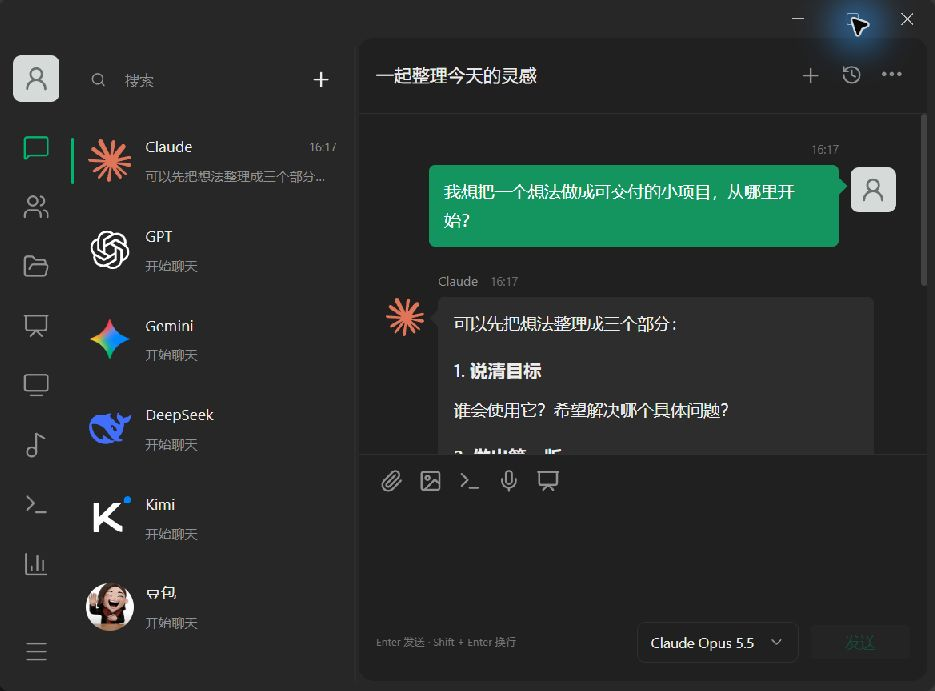

<p align="center"></p>

<h1 align="center">NibbleDesk</h1>
<p align="center"><strong>Your AI companions, one desktop away.</strong><br>聊天、创作、听音乐，让 AI 伙伴常伴桌面。</p>
<p align="center">Windows x64 · Multi-model chat · Agent tasks · Desktop Island</p>
<p align="center"><a href="docs/BUILD.md">Build</a> · <a href="#screenshots--界面预览">Screenshots</a> · <a href="docs/SPEECH.md">Local speech</a> · <a href="CONTRIBUTING.md">Contribute</a> · <a href="LICENSE">AGPL-3.0</a></p>

**NibbleDesk** is a Windows AI workspace that brings multi-model conversations, agent tasks, document previews, music and a desktop island into one place. Connect your own model services and keep each companion’s conversations separate. Model requests go to the service you configure; speech transcription runs locally.

Nibble means a small bite, a nod to our hamster mascot. **瓜瓜** remains the Chinese name shown in the desktop app.

瓜瓜是面向个人使用的多模型 AI 聊天与创作桌面工作台。你可以为不同伙伴选择服务商、模型和角色，在独立对话中交流，也可以把几位伙伴加入群聊，共同完成任务。文件阅读、演示文稿、音乐和桌面 Island 放在同一套界面中，减少在工具之间来回切换。

当前发布为 **1.7.2 开发源码预览**，主要面向 Windows 10/11 x64；欢迎试用、报告问题和参与改进。此仓库发布源码，安装包另行验收和发布。

## Screenshots / 界面预览

以下为应用实际窗口，使用独立演示数据展示界面；示例文字不代表真实模型调用或能力测评。



## 可以做什么

- **多模型伙伴**：六位默认伙伴，可新增伙伴、选择模型、配置角色；支持 APImart、DeepSeek 官方、火山引擎及自定义兼容 API。
- **单聊与群聊**：独立历史会话、按成员顺序讨论、指定成员回答、停止生成。新对话与伙伴入口分开管理。
- **Agent 任务**：基于 DeepSeek Harness，按对话提供文件工作目录，支持文件生成、JavaScript 检查和测试、审批与结果交付。
- **文件与 PPT**：文件中心、右侧快速阅读、批注、页面/网格切换、演示文稿生成及用户自有 PPTX 模板导入。
- **桌面 Island**：顶端快聊入口，悬停展开、文件拖入、模型切换、语音输入、音乐歌词和音波；支持勿扰及全屏抑制。
- **音乐与影音**：集成 Folia 网页音乐能力及本地网易云 API 宿主；抖音、小红书、B 站使用独立网页会话，可切换视频小窗。
- **本地语音与用量**：SenseVoice 中文优先识别及 Whisper 备用本地组件；按接口返回值记录 Token，并依据可配置价格估算费用。

## 快速开始

需要 **Windows x64、Node.js 24、npm、Git**。模型服务需要你自己的账户和密钥；服务费用由对应平台结算。

```powershell
git clone https://github.com/Berenda0525/nibbledesk.git
cd nibbledesk
npm ci
npm run resources:node
npm run build
npm run desktop
```

在设置中添加服务地址和 API Key，再选择账户实际可用的模型。内置模型名称和目录不代表每个账户都有调用权限，平台可能调整目录和接口。

源码仓库不携带办公引擎、Whisper 模型、音乐构建产物或 Windows 原生辅助程序。完整功能的准备步骤见 **[构建与运行](docs/BUILD.md)**。缺少可选资源时，相应功能可能显示不可用；完整安装包需要将这些资源准备齐全。

## 代码结构

| 目录 | 职责 |
| --- | --- |
| `src/` | React 界面、聊天、文件、PPT、音乐和用量工作区 |
| `core/` | 模型服务、会话调度、任务策略、文档生成与用量计价 |
| `desktop/` | Electron 窗口、IPC、文件/密钥存储、音乐宿主和 Island |
| `shared/` | 前后端共用的工具与数据处理 |
| `scripts/` | 资源准备、构建、源码清单、发行及公开文件检查 |
| `tests/` | 本地模拟接口、业务回归和桌面验收脚本 |
| `resources/` | 可选运行组件的来源、校验信息和许可证 |

开发和安装产生的数据在本机写入独立目录。密钥、对话、附件、网页登录状态、缓存和测试输出都不属于公开仓库。

## 参考、集成与致谢

| 项目 / 服务 | 与瓜瓜的关系 |
| --- | --- |
| [APImart](https://docs.apimart.ai/) | 可选模型服务平台；瓜瓜调用其公开兼容接口，由使用者自行配置密钥 |
| [ClawChat](https://clawling.com/chat/) | 多个 AI 作为聊天伙伴、单聊与群聊体验的产品参考 |
| [DeepSeek Harness](https://github.com/deepseek-ai/deepseek-harness) | Agent 执行框架依赖；提供插件、会话与任务执行基础 |
| [Folia](https://github.com/chthollyphile/folia-major) | 音乐能力的上游项目；固定版本源码构建后与瓜瓜宿主集成 |
| [eIsland](https://github.com/JNTMTMTM/eIsland) | Windows 顶部 Island 形态与交互参考 |
| [Open Island](https://github.com/Octane0411/open-vibe-island) | AI 助手桌面入口与展开/收起体验参考 |
| [sherpa-onnx](https://github.com/k2-fsa/sherpa-onnx) / [SenseVoice](https://github.com/FunAudioLLM/SenseVoice) | 可选本地中文语音识别；引擎与模型适用不同许可，见 [语音说明](docs/SPEECH.md) |
| [whisper.cpp](https://github.com/ggml-org/whisper.cpp) / [Whisper](https://github.com/openai/whisper) | 本机语音识别引擎与模型 |
| [ZetaOffice](https://zetaoffice.net/) / [LibreOffice](https://www.libreoffice.org/) | Office 文档页面转换和阅读所需的可选办公引擎 |

感谢 Electron、React、Vite、Lucide、Lobe Icons、NetEaseCloudMusicApiEnhanced 以及其他依赖的作者和贡献者。瓜瓜是独立项目，以上引用不表示相关项目、品牌或服务商为瓜瓜提供官方背书。

Folia 集成固定在 `f3a90708afbec884934d8bca16bbd0a35feeb6a7`。显示文案、导航、会话隔离以及歌词/音频桥接的改动保留在本仓库；具体来源、许可证和品牌素材说明见 **[第三方引用](docs/THIRD_PARTY.md)** 与 [NOTICE.txt](NOTICE.txt)。

## 当前边界

- Agent 执行器目前主要支持 JavaScript/网页文件和 Node.js 测试；不是任意终端、任意语言环境的完整替代品。运行代码前需要用户审批。
- 模型请求会把选中的消息和相关附件内容发送给所配置的服务。音频转写由本机引擎处理，得到的文字仍需人工核对。
- 用量金额是估算；未返回的 Token 不能补算为实际账单。各服务的余额或账单同步能力不同。
- 第三方音乐和视频平台的登录、网络、内容权限和网站更新会影响可用性。瓜瓜不提供音乐或视频内容的额外授权。
- 中文语音、复杂文档、Island 动画与游戏/全屏识别仍需在不同机器上验收；源码测试通过不代表所有真实环境都已覆盖。
- WPS 模板由用户自行提供并确认使用权；本仓库不分发付费模板或个人文档。
- 依赖审计仍有上游已知风险，具体包、检查日期和当前处理状态见 [安全说明](SECURITY.md)。

## 开发与参与

```powershell
npm test
npm run check:public
npm run build
```

提交问题时请提供版本、复现步骤和脱敏截图；不要上传 API Key、登录 Cookie、聊天数据库或私人附件。参见 [贡献指南](CONTRIBUTING.md) 和 [安全说明](SECURITY.md)。

## 项目定位与社区倡议

瓜瓜由个人出于学习、研究和交流目的维护，当前免费分享。维护者不通过本项目售卖软件或提供收费授权。欢迎社区持续改进、修复和贡献，并倡议衍生项目继续免费分享。

第三方的收费分发、付费服务、宣传和衍生产品不代表本项目维护者，也不构成维护者对其经营活动的背书。请勿冒用维护者身份，或将衍生项目宣传为瓜瓜官方产品。修改和再分发应遵守适用许可，保留来源、权利声明，并按许可标明修改。

本段说明项目定位和社区倡议，不改变 AGPL-3.0-only 及第三方许可授予的权利。软件按现状提供；相关责任以适用法律及许可证为准，免费分享并不替代第三方授权义务。

## 许可证

瓜瓜应用源码采用 **[AGPL-3.0-only](LICENSE)**。第三方组件保留各自许可证；商标、品牌图形和第三方媒体素材的权利归原权利人所有。使用、修改或分发时，请同时遵守适用的许可证和品牌条款。
